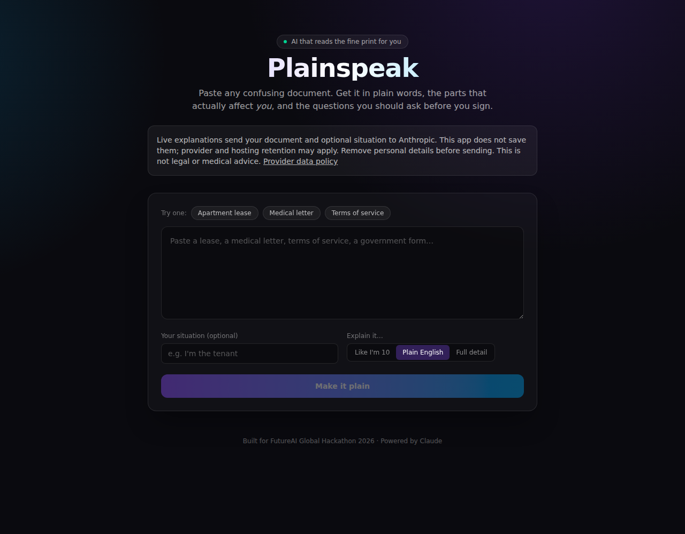
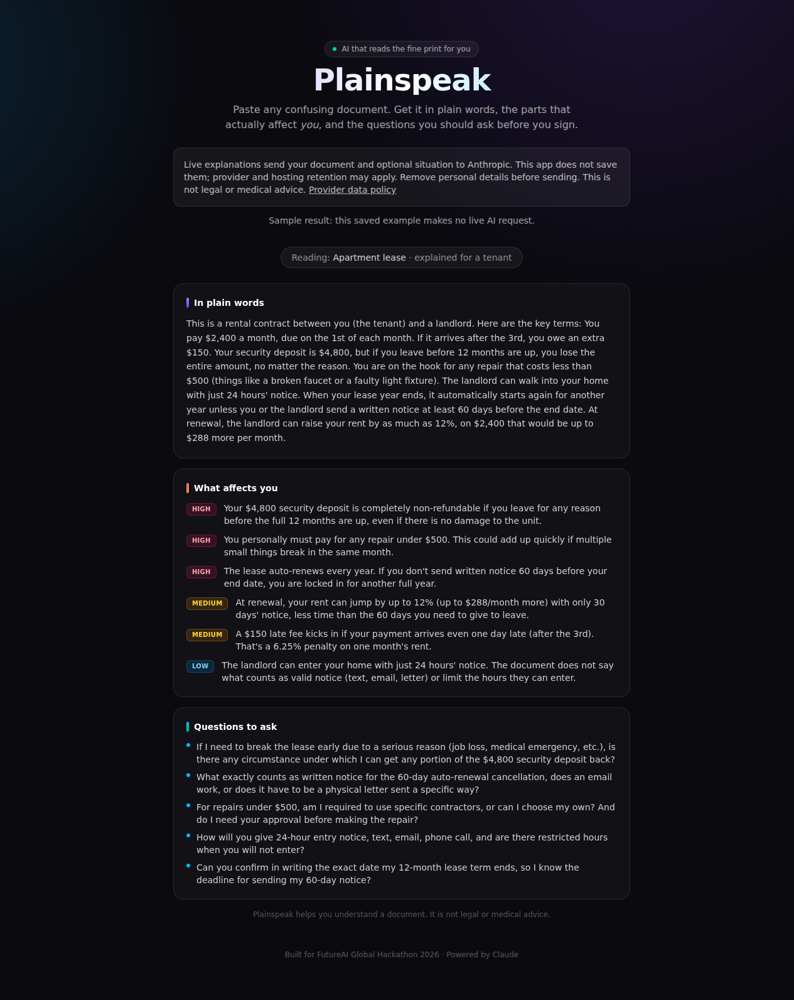

# Plainspeak

**Understand a dense lease, medical letter or terms of service before you decide what to ask next.**

Paste text, choose a reading level and optionally say who you are. Plainspeak returns a plain-language explanation, the points that may affect you and questions to ask the author. It helps a small-business owner or customer read unfamiliar language. **It is not legal, medical or financial advice.** Check the original and consult a qualified professional before acting.



## What it replaces and leaves out

For short, pasted-text explanations, this can cover a narrow document-understanding job you might otherwise use [Adobe Acrobat AI Assistant](https://www.adobe.com/acrobat/generative-ai-pdf.html) or [Humata](https://www.humata.ai/) for. It does not replace their full document tools or professional review.

| Included | Left out compared with paid document platforms |
|---|---|
| Three reading levels, personalized points and questions | No professional advice, accuracy guarantee or legal/medical sufficiency check |
| One pasted document, up to 16,000 characters | No PDF upload, OCR, scanned forms, multi-document search or comparison |
| An explanation in the browser | No saved library, source-linked citations, collaboration, accounts, PDF editing or e-signatures |
| A self-hostable web app | No built-in payment, subscription quotas, support SLA or managed hosted tier |

## Try the sample in five minutes

Requires Node.js 22+ and [pnpm](https://pnpm.io/installation):

```sh
git clone https://github.com/OrionArchitekton/plainspeak.git
cd plainspeak
pnpm install --frozen-lockfile
pnpm dev --hostname 127.0.0.1
```

Open [the frozen lease sample](http://localhost:3000/?demo=lease). It needs no API key or paid request and is labeled **Sample result**. It shows a saved example response, not a new explanation of your document.



To explain new text, copy `.env.example` to `.env.local`, supply your own `ANTHROPIC_API_KEY`, restart, open [the input screen](http://localhost:3000), paste redacted text and click **Make it plain**. Your provider bills live requests. The example buttons fill text; submitting those examples also makes a live request. `ANTHROPIC_MODEL` can override the default model. Never put keys in a `NEXT_PUBLIC_` variable.

## Privacy: no document storage by this app

The app has no document database, upload store, saved history, analytics or browser local-storage feature. Documents and explanations are held in request/browser memory; the API returns `Cache-Control: no-store`. **Live requests send your document and optional situation to Anthropic.** This is cloud processing, not an offline or zero-retention promise.

[Anthropic's API retention policy](https://privacy.claude.com/en/articles/7996866-how-long-do-you-store-my-organization-s-data) describes standard retention and exceptions. Your hosting provider/proxy may keep request metadata; inspect its logging settings and do not enable request-body capture. If configured, Upstash stores rate-limit identifiers/counters, not document bodies. Provider retention and hosting behavior are separate from the app's no-document-storage behavior. Remove personal details and use fictional samples for testing. Do not assume suitability for sensitive medical records or a regulated workflow.

The notice appears before submission. Model prompts request no invented facts and no professional advice, but an AI can still make mistakes. Provider exception details are not returned to the browser.

## Deploy your own copy

The [deploy runbook](docs/runbooks/deploy.md) covers a local production build and a Vercel setup path, provider costs, privacy checks, validation and rollback. No deployment is created by these instructions.

Rate limiting is optional: with Upstash configured, the route attempts a six-per-minute per-IP limit. Without it the endpoint is unthrottled. With a configured limiter, Redis failures return 503 without calling the model; invalid input is rejected before taking a slot. It is not authentication, a spending cap or a paid-tier quota. Restrict access and provider spend before any public rollout. Production readiness for a paid tier requires additional controls.

## Paid hosted tier (proposal)

**Suggested $9 USD/month for up to 50 explanations**, each within the existing text limit. Proposed value: no API key setup for the customer, browser access and basic support. This tier is **not implemented or offered yet**. Billing, customer access, enforceable monthly quotas, cost controls, support terms and hosting/provider privacy review must be completed and approved before charging. No checkout or subscription was created. See [SWAPMEET.md](SWAPMEET.md).

## License proposal

MIT is proposed for Dan's approval in [the draft license](docs/PROPOSED-MIT-LICENSE.txt). There is no adopted root LICENSE file. The old README said MIT but no LICENSE file was present; this PR leaves adoption to Dan. Confirm licensing before redistribution or sale.

## Development

```sh
pnpm test
pnpm exec tsc --noEmit
pnpm build
```

Vitest covers prompt/parsing behavior and the HTTP validation/privacy boundary with a fake SDK response, without keys or live AI requests. No ESLint configuration is present: `pnpm lint` opens an interactive setup prompt and exits 1 in a non-interactive run. TypeScript and the production build are the available static checks. See the [spec](specs/plainspeak-spec.md). Historical hackathon material remains in `demo/` and `docs/submission/`.
